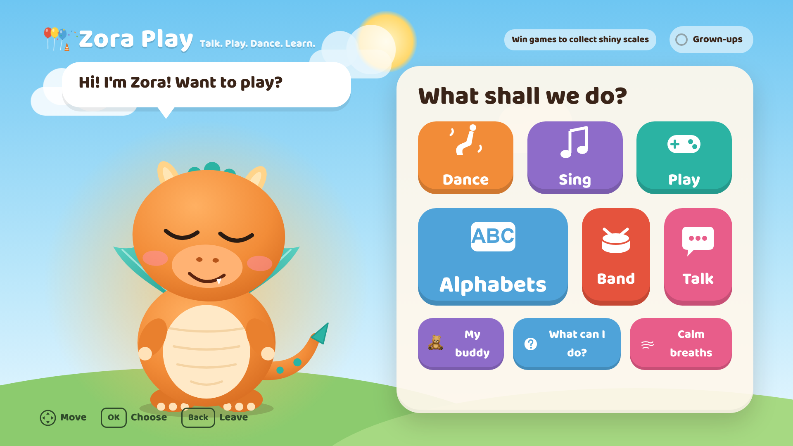

<p align="center"></p>

# Zora Play — Your Interactive TV Buddy

**Talk. Play. Dance. Learn.** Zora Play is a friendly buddy who lives on your TV. Children (about 3 to 8) use the Fire TV remote to make their buddy dance, sing, play games, learn the alphabet, make music and take calming breaths. There are four buddies to choose from: Zora the baby dragon, Mimi the kitten, Bruno the pup and Teddy the bear, each with its own name and voice.

It works offline, has no account, no ads and no analytics, and the buddy says lines from a fixed, reviewed list. The one online feature is optional: when the TV is online, **Tell me a joke** can fetch a brand-new, safety-checked, voiced joke written live by Amazon Bedrock (for ages 3 to 8, in simple words; it asks the service on every press while the TV is connected to Wi-Fi, and with no connection it tells one of 131 stored jokes straight away; a grown-up can switch it off in Settings).

Built for the Amazon Developer Hackathon 2026: **Fire TV track** (runs on Fire OS as a web app in an Android WebView, also tested on the Vega Virtual Device), with two mini challenges: **AWS Builder** (Amazon Bedrock, Guardrails, CloudWatch, plus Lambda, API Gateway and Polly for the optional live joke) and **Open Source** ([TV Audio Flow](packages/tv-audio-flow), an MIT-licensed audio-sequencing library). See [Hackathon submission at a glance](#hackathon-submission-at-a-glance).

Repository: https://github.com/Vishnu2663/zora_play



## What's inside

| Feature | What it does |
|---|---|
| **My buddy** | Pick Zora, Mimi, Bruno or Teddy. Each has its own colours, name, and speaking voice (pitch and pace). The buddies are light 2D SVG characters. |
| **Dance Studio** | Wiggle, Robot, Silly and Slow dances with a real song. Faster and Slower change the animation timing and the music tempo (5 flame levels). Again and Stop. |
| **Dance Maker** | The child picks 4 moves (wave, jump, side step, turn around, hands up, bounce) and the buddy performs that dance on a loop, at the speed they choose. |
| **Sing (Rhyme Room)** | Five original sung songs with karaoke word highlighting. Play, Pause, Resume, Restart, Stop and the remote's Play/Pause key. When a song ends, the next one starts 2 seconds later while the Rhyme Room is open. |
| **Play** | Shape Match (5 rounds, gentle retry, hint glow), Zora Says (the buddy performs moves and the child copies; later rounds are two-move memory combos) and Animal Sounds (11 real animal recordings; a text clue appears when sound is off). |
| **Alphabets** | All 26 letters, each with a picture, spoken one at a time with a gentle tune and speed control. |
| **Band** | Ten instruments to play with the remote (piano, guitar, xylophone, trumpet, drum, flute, harp, maracas, bells, tambourine), each with its own sound; the buddy dances along. |
| **Talk** | Five conversation starters (animals, counting to five, favourite colour, dancing, rhymes) plus 16 big phrase buttons ("Faster!", "Again!", "Tell me a joke", "I'm sad"...). Every reply is a fixed, reviewed, voiced line. |
| **Calm breaths** | A 3-cycle dragon-breath exercise; the buddy's belly fills and empties with the child. Offered automatically when a child says they are sad, scared or angry. |
| **What can I do?** | A help screen that shows the commands the buddy understands. |
| **Shiny scales** | Finishing a game earns a scale on the shelf (this session only, nothing is saved). |
| **Settings** | A grown-ups area (hold OK for 3 s): sound, volume, voice on or off, gentle motion, wind-down timer, session reset, privacy notes and audio diagnostics. |

### Things that make Zora Play different

- **Spoken, not beeped:** every line is a recorded voice clip (263 lines, for each of the four buddies), so the buddy talks like a character. The clips are made offline with Piper (see [docs/VOICE.md](docs/VOICE.md)).
- **One sound at a time:** speech, songs and animal sounds go through a small sequencing library (`packages/tv-audio-flow`), so a new line replaces the old one and nothing overlaps. Music and effects quieten while the buddy speaks.
- **Contextual follow-ups:** "Dance" then "Faster!" then "Stop!" then "Again!" all resolve against what the buddy is doing.
- **Feelings-aware:** "I'm sad" makes the buddy supportive and offers a dragon breath or a game.
- **Privacy guard:** if a child tries to say a name, address or number, the buddy says it's private and nothing is stored.
- **Sleep mode and wind-down timer:** "Go to sleep" puts the buddy to bed; after the time a parent sets, the sky turns to night and the buddy suggests the lullaby.
- **Live AI jokes, with a safe fallback:** press Tell me a joke and, when online, Amazon Bedrock writes a new joke on the spot and Amazon Polly speaks it in the buddy's voice (about 2 to 4 seconds). If the TV is offline, the call is slow, or anything looks unsafe, a stored joke is told instead.
- **AI-assisted, human-approved content:** the stored jokes, riddles, animal facts, chat replies and bedtime lines are written with Amazon Bedrock at build time, checked by a Bedrock Guardrail, and approved by a person (see [How AWS is used](#how-aws-is-used-aws-builder-mini-challenge)).

## Architecture in one picture

```
Remote keys / Talk buttons / (future voice)
        │ text or structured command
        ▼
 normalize ─► parseCommand ─► registry.validate (allowlist) ─► MiloBrain (session context)
                                                                  │ Reaction {say, mood, effects, choices}
                     ┌──────────────────────┬─────────────────────┼──────────────────────┐
                     ▼                      ▼                     ▼                      ▼
             CharacterMachine         AudioService /          Game engines             Screens
          (states, safety caps)      SpeechQueue (clips)   (pure, seeded, testable)  (React, D-pad focus)
```

`src/core/` is platform-agnostic TypeScript with no DOM, audio or network access. That is where every decision is made, and it is unit-tested. `src/web/` renders it. (The brain class keeps its original name, `MiloBrain`.) See [docs/ARCHITECTURE.md](docs/ARCHITECTURE.md).

## Run it in a browser

Requires Node 22.18+ (built-in TypeScript type stripping is used for tests).

```bash
npm install          # esbuild, react, react-dom, typescript,
npm test             # 167 unit tests (node:test)
npm run typecheck    # strict tsc on the core
npm run typecheck:ui # typechecks the React UI too
npm run build        # -> dist/index.html (one self-contained file) plus dist/audio and dist/intro
npm run serve        # open http://localhost:8080 and use the arrow keys, Enter, Esc
```

Keyboard = remote: **arrows** move, **Enter** selects, **Esc/Backspace** is Back. Hold **Enter** on "Settings" for 3 seconds.

`scripts/e2e.py` (Playwright) and `scripts/tour.mjs` drive the screens with remote keys only. They are not re-run for every change; run them yourself with `npm run e2e` and `npm run tour` (`pip install playwright && playwright install chromium` first for e2e).

## Put it on Fire TV (Fire OS)

Zora Play runs as a web app inside an Android WebView (`firetv/`, package `com.zoraplay.firetv`, minSdk 22 so Fire OS 5 and newer). The built `dist/` folder is copied into the app's assets and loaded from `file:///android_asset/index.html`.

You need the Android SDK (Android Studio installs it), JDK 17 and `adb`. A Fire TV device needs ADB debugging on (Settings > My Fire TV > Developer Options). The Android TV emulator also works.

```bash
npm run build:firetv                     # build the web app and copy it into firetv/app/src/main/assets
cd firetv
echo "sdk.dir=<path to your Android SDK>" > local.properties   # once; use forward slashes on Windows
./gradlew assembleDebug                  # -> app/build/outputs/apk/debug/app-debug.apk
adb connect <fire-tv-ip>:5555            # skip for an emulator that is already running
adb install -r app/build/outputs/apk/debug/app-debug.apk
adb shell am start -n com.zoraplay.firetv/com.miloplay.tvbuddy.firetv.MainActivity
```

`bash scripts/firetv-run.sh <fire-tv-ip>` does the same steps in one go on a Mac or Linux machine (it finds the TV on your Wi-Fi if you leave the IP out).

### Run it on the Vega Virtual Device (Vega OS)

The same `dist/index.html` is what the Vega app (`vega-app/`, a React Native Kepler WebView shell) loads. With the Vega SDK installed:

```bash
export VEGA_PROJECT=$PWD/vega-app
npm run build:vega                      # build the web app and copy it into vega-app/assets
cd vega-app && npm install && npm run build:debug
vega virtual-device start               # boots the simulator (wait for "Virtual device ready")
vega run-app build/aarch64-debug/zoraplayvega_aarch64.vpkg   # use the x86_64 .vpkg on an Intel Mac
```

The simulator window shows the app and an on-screen remote. See [docs/WORKFLOW.md](docs/WORKFLOW.md).

### What was tested where

- Unit tests (167) and typecheck: pass.
- Desktop browser (Chromium): every screen, the Talk section, the buddies and the intro.
- Android TV emulator (`FireTV_API30`), Fire OS WebView: install, launch, intro, home screen, the Talk jokes, and the no-Wi-Fi fallback.
- Physical Fire TV Stick (Fire OS 7): install, launch, every section and the live joke, recorded on video.
- Vega Virtual Device (Vega SDK 0.24, aarch64 debug package): installed, launched and every section used with the on-screen remote.

## Zora Play's speaking voice

The buddies speak from bundled voice clips generated offline with Piper and the `en_US-ljspeech-medium` voice (LJ Speech, public domain), then pitch-shifted per buddy with ffmpeg. See [docs/VOICE.md](docs/VOICE.md) for how the clips are made and how playback works. Settings > Audio diagnostics runs real playback tests on the device.

## Voice input: what's real

Talking to the buddy out loud is a goal, not a claim. A Fire TV app cannot reliably receive microphone audio or transcripts today, and the Alexa Voice Remote's mic button is handled by the system. So:

- `src/web/voice.ts` defines `VoiceInputService` (`startListening/stopListening/cancelListening/getStatus/onTranscript/onError`, 8-second hard cap, no recordings kept). The shipped adapter reports **unavailable**.
- Children use the **Talk** buttons, which send phrases through exactly the same parser a transcript would.
- A **developer console** (Settings > Developer console) lets you type transcripts for testing. It is labelled "DEV ONLY · typed text, not voice".

When a supported speech API is available, implement one `VoiceAdapter` and call `voice.use(adapter)`; nothing else changes.

## Privacy & safety

No account, ads, analytics, chat, or browsing. The only network call is the optional fresh joke (Settings > Fresh jokes online): one small request that carries only the buddy's id, never any child information, and it can be switched off. Nothing is persisted except the chosen buddy (a local setting on the device): settings and scales live in memory only. The parser is an allowlist; unknown input never triggers anything but a friendly "I don't know that one" with suggestions. The buddy never echoes arbitrary words. Personal-info patterns trigger a privacy reply and are not stored.

This is not a legal compliance review. Before publishing to the Appstore, review Amazon's requirements for apps directed at children and your local children's privacy law.

## Known limitations

- No real voice input (see above).
- The animal sounds are third-party recordings (public domain or CC0) that were chosen by title and checked for length and loudness; cow, duck, pig and monkey are not included because no suitable open recording was found.
- Some AI-written jokes are weak; only the ones a person approved are in the app.
- Fonts fall back to the device's rounded/system fonts; no font files are bundled.
- The Rhyme Room song titles and lyrics are recorded audio, so they still say "Milo" (the project's working name).

## Project layout

```
src/core/        parser, registry, brain, character state machine, games, rhymes, band, responses, talk
src/web/         React TV UI: App shell, screens, 2D buddy, focus engine, audio, speech, voice seam
test/            unit tests (node:test)
scripts/         build, copy-to-firetv, Bedrock pipeline, voice and song generators, e2e and tour tests
firetv/          Fire OS wrapper app (Android WebView), package com.zoraplay.firetv
packages/        tv-audio-flow: the audio sequencing library
public/          audio (voice clips, songs, animal sounds) and the intro pictures
voice/           phrase list, voice profiles and the AI-generated line files
docs/            architecture, voice, AWS, demo script, submission draft
vega/App.tsx     reference WebView shell for the optional Vega OS path
```

## How AWS is used (AWS Builder mini challenge)

The app on the TV has no AWS SDK and no keys. AWS is used in two ways:

1. **At build time** (the main use): Amazon Bedrock writes the extra lines Zora Play can say (jokes, riddles, animal facts, chat replies, bedtime lines), a Bedrock Guardrail checks them, and a person approves each one. Approved lines ship inside the app as plain text and recorded voice clips.
2. **At run time, for one optional button**: when the TV is online, **Tell me a joke** can fetch a brand-new joke (`infra/joke-service`: API Gateway, then a Lambda that calls Bedrock with a Guardrail on the output and speaks the joke with Amazon Polly). Only the buddy's id is sent. If the TV is offline, the call is slow or anything looks unsafe, a stored joke is told instead. A grown-up can switch it off in Settings.

```
 BUILD TIME (developer laptop)                                                RUN TIME (Fire TV, offline)
 -----------------------------                                                ---------------------------
 bedrock-generate.mjs -- Converse API --> Amazon Bedrock (Nova Lite / Nova Pro)
        |                                   '- Guardrail checks the output -.
        v                                                                   |      CloudWatch Logs
 voice/generated/*.json  (pending) <----------------------------------------'      /aws/bedrock/modelinvocations
        |                                                                          (every call logged)
 bedrock-check.mjs -- ApplyGuardrail --> Bedrock Guardrails (zora-play-kids)
        |   + our own local rules  ->  voice/generated/safety-report.json
        v
 review-lines.mjs  (a human approves or rejects every line)
        v
 import-approved.mjs -> src/core/generatedLines.ts --> Piper voice clips, 4 buddies -->  app: plain text + mp3,
                                                                                         no AWS SDK, no network
```

| AWS service | What it does here |
|---|---|
| Amazon Bedrock (Converse API) | Writes lines as strict JSON with Amazon Nova Lite and Nova Pro |
| Amazon Bedrock Guardrails | Child-safety filters and denied topics on the model output, then again on every line (`ApplyGuardrail`) |
| Amazon CloudWatch Logs | Bedrock model invocation logging: prompts, replies, token counts, latency |
| AWS Lambda + Amazon API Gateway | The optional live-joke service (`infra/joke-service`), rate limited and with a small concurrency cap |
| Amazon Polly | Speaks a live joke in a voice that fits the chosen buddy |
| AWS IAM | Standard credentials; no keys in the repo (`.env.example` lists the variables) |

Real results: 226 lines generated and checked (206 jokes plus 20 riddles, animal facts, chat replies and bedtime lines); a human approved 148, rejected 17, and 61 jokes are still waiting for review. Only the approved lines are in the app, voiced for all four buddies. The guardrail blocked every unsafe test line we tried. We also found and fixed a real problem: the guardrail's prompt-attack filter was blocking our own prompts. The fix, the logs and all details are in [docs/aws-bedrock.md](docs/aws-bedrock.md); guardrail settings are in [scripts/bedrock-guardrail-setup.md](scripts/bedrock-guardrail-setup.md).

A test (`test/bedrock-pipeline.test.ts`) fails if anything under `src/` mentions the AWS SDK; the one optional online call in the app is a plain HTTPS request (`src/web/liveJoke.ts`), and every reply is checked again on the device (`src/core/liveJoke.ts`). Run the checks with `npm test` (no AWS needed).

## Hackathon submission at a glance

| Requirement | Where it is met |
|---|---|
| **Primary track: Fire TV** | A kids' buddy app that runs on Fire OS (Fire TV Stick) as a web app in an Android WebView (`firetv/`), driven only by the remote. Also runs on the Vega Virtual Device (`vega-app/`). |
| **Mini challenge: AWS Builder** | Amazon Bedrock (Converse API, Nova Lite and Nova Pro) plus Guardrails and CloudWatch, and Lambda, API Gateway and Polly for the live joke. See [How AWS is used](#how-aws-is-used-aws-builder-mini-challenge) and [docs/aws-bedrock.md](docs/aws-bedrock.md). |
| **Mini challenge: Open Source** | [packages/tv-audio-flow](packages/tv-audio-flow): MIT licence, README, 36 tests, runnable examples; it keeps speech, songs and animal sounds from overlapping and lets Back cancel instantly. |
| **Public repo with an open-source licence** | This repository, MIT ([LICENSE](LICENSE)). |
| **Demo video (under 3 minutes)** | Real Fire TV Stick footage, then the Vega simulator, then both mini challenges. Script and notes: [docs/DEMO-SCRIPT.md](docs/DEMO-SCRIPT.md). |
| **How to test it** | `npm install && npm test && npm run build && npm run serve` (no AWS account needed), or install the APK as described above. |
| **Honest AI use** | See [Credits and AI use](#credits-and-ai-use) and [docs/SUBMISSION.md](docs/SUBMISSION.md). |
| **No secrets** | No keys, tokens or `.env` in the repository; only `.env.example` with empty placeholders. Build-time AWS access uses your own AWS profile. |

## Open source: TV Audio Flow

`packages/tv-audio-flow` is a small, dependency-free TypeScript library (MIT) for TV apps that play many sounds: a sequence of clips, delays and actions where each step starts only when the previous one really ended, and one shared channel lets only one sequence play at a time, so a new session never overlaps an old one and a Back key cancels everything at once. It has 36 tests (race conditions, pause and resume, typed errors), two runnable examples (`npm run examples`), a README, a changelog and a contributing guide. Run `cd packages/tv-audio-flow && npm install && npm run check`.

## License

MIT — see [LICENSE](LICENSE). Zora Play, his artwork, songs and sounds are original to this project. Dependency licenses: [LICENSES.md](LICENSES.md).

## The buddy and the tour test

- The four buddies (Zora, Mimi, Bruno, Teddy) are flat SVG drawings (`src/web/Milo.tsx`) with the skin colours from `src/core/avatars.ts`. One pose engine animates all of them, so every move works for every buddy. There is no 3D and no WebGL, so they look the same on every TV.
- `npm run build && npm run tour` drives every screen like a remote in headless Chrome (focus, layout, errors, every game, settings, then a random-key "monkey" run). It exits with code 1 if anything fails.

## Audio sequencing: tv-audio-flow

Spoken lines, animal sounds, the alphabet and the Rhyme Room intro/title/song are played by the [tv-audio-flow](packages/tv-audio-flow) library (vendored in `packages/tv-audio-flow`, linked with `"tv-audio-flow": "file:packages/tv-audio-flow"`). Each step starts only when the previous one really ended, one shared `AudioChannel` lets only one sequence play at a time, and leaving a screen cancels it (`src/web/audioFlow.ts`, `src/core/flowAdapter.ts`). Setup: just `npm install` here (the library's built `dist/` is committed). To work on the library itself: `cd packages/tv-audio-flow && npm install && npm run check`.

## Credits and AI use

- **AI tools used to build this project:** Kiro (initial planning, folder structure and the first few features; the owner then moved to Claude Code, on a paid plan, because Kiro's session limit was reached) and Claude Code (code, tests, debugging and documentation, directed and reviewed by the owner), ChatGPT (song lyrics and rhymes, prompt writing and architecture ideas, edited by the owner), Suno (songs and dance music), and Amazon Nova through Amazon Bedrock (the buddy's extra jokes, riddles, animal facts, chat replies and bedtime lines, each checked by a Bedrock Guardrail and approved by the owner). No code was copied from an earlier project; the project was built during the hackathon.
- Songs and dance music: made with Suno. Lyrics: written with ChatGPT and edited by the owner. Details and licenses: [LICENSES.md](LICENSES.md).
